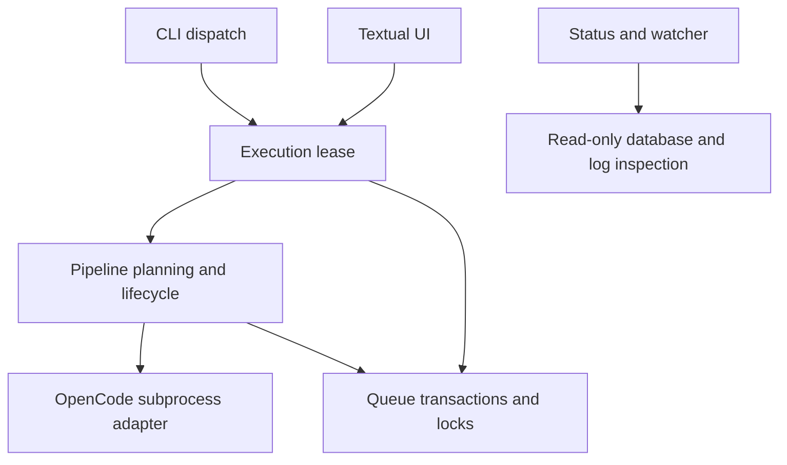

# Python development

FlowForge supports Python 3.10+ and Unix file locking. Headless commands use the
standard library. UI dependencies and development tools have separate manifests.

## Environment and checks

From the repository root:

```bash
python3 -m venv .venv
.venv/bin/python -m pip install -r requirements-dev.txt
.venv/bin/python scripts/check.py
```

The check command runs Ruff lint, Ruff format verification, mypy, compilation and
the complete unittest suite. It stops at the first failure and uses the same
interpreter for every check. CI runs this command with UI dependencies installed.
Separate CI jobs compile and test headless environments on Python 3.10, 3.12 and 3.13.

For a headless environment without development tools:

```bash
python3 scripts/check.py --stdlib-only
```

To format or run a focused test:

```bash
.venv/bin/python -m ruff check . --fix
.venv/bin/python -m ruff format .
.venv/bin/python -m unittest tests.test_architecture
```

For UI use without development tools, install `requirements-ui.txt` in the virtual
environment. Headless commands require neither dependency manifest.

Both `python -m unittest discover` and the older `discover -s tests` invocation
work. UI tests skip when Textual is unavailable. Shared fixtures in `tests/support`
provide disposable projects, a local fake OpenCode executable, notification
adapters and synthetic SQLite databases. Fixtures register resource cleanup with
the test case; test imports initialize isolated project variables before importing
application modules.

## Structure

Importable modules use underscore names. The `flowforge`, `run-task.py`,
`tasks-ui.py` and `watch-task.py` scripts preserve existing launch commands.
The UI lives in `flowforge_ui.py`, the watcher in `flowforge_watch.py`, and argument
parsing in `flowforge_cli.py`. CLI help remains usable without UI dependencies.



`flowforge_models.py` holds shared result and normalized workflow types. Storage,
workflow parsing and inspection avoid dependencies on entry-point scripts.
Legacy engine names remain explicit re-exports for existing Python callers.
Use `from flowforge_ui import TasksUI` and `from flowforge_watch import build_status`
when importing these interfaces from Python. Tests import the same modules; they
do not load executable filenames through `importlib`.

## Conventions

Use readable names, four-space indentation, grouped imports and one statement per
line, following [PEP 8](https://peps.python.org/pep-0008/). Ruff owns formatting with
a project line length of 100 and a Python 3.10 target. Its rules check syntax,
undefined and unused names, imports, supported modern syntax and common mistakes;
the settings live in [pyproject.toml](../pyproject.toml), following
[Ruff's configuration format](https://docs.astral.sh/ruff/configuration/).

Annotate public functions and resource-owning classes. Prefer `Path`, built-in
collection types and `T | None`. Use dataclasses for named results and `TypedDict`
for normalized records. Keep arbitrary JSON fields where the queue contract
requires preserving unknown data. Type hints support static analysis; runtime
configuration and queue validation remain necessary, as described by
[PEP 484](https://peps.python.org/pep-0484/).

Mypy checks all application modules, notification modules and the check script.
Storage, workflow parsing, subprocess handling and shared models require complete
function annotations. Other modules use gradual checking, including annotated
functions and the bodies of unannotated functions. The configuration follows
[mypy's documented options](https://mypy.readthedocs.io/en/stable/config_file.html).

Keep execution ownership in `Execution`; acquire canonical locks before recovery.
Use storage transactions for queue changes. Release file handles, SQLite
connections, processes and locks through context managers or `finally`. Catch
specific errors during parsing and validation; broad catches belong at explicit
failure-isolation or resource-cleanup seams and must preserve failure information.

Keep functions focused on one responsibility and document invariants or surprising
behavior. Extract helpers when callers share behavior or a function hides a
meaningful policy. Keep provider-specific behavior inside its adapter. Changes to
the event stream and JSON envelopes must preserve their documented contracts.

Test externally visible behavior with isolated fixtures. Include failure and
cancellation paths when changing execution ownership. OpenCode tests use local
fixtures and Matrix HTTP is mocked. Keep `.env`, queues, private agent prompts and
run artifacts out of commits.
