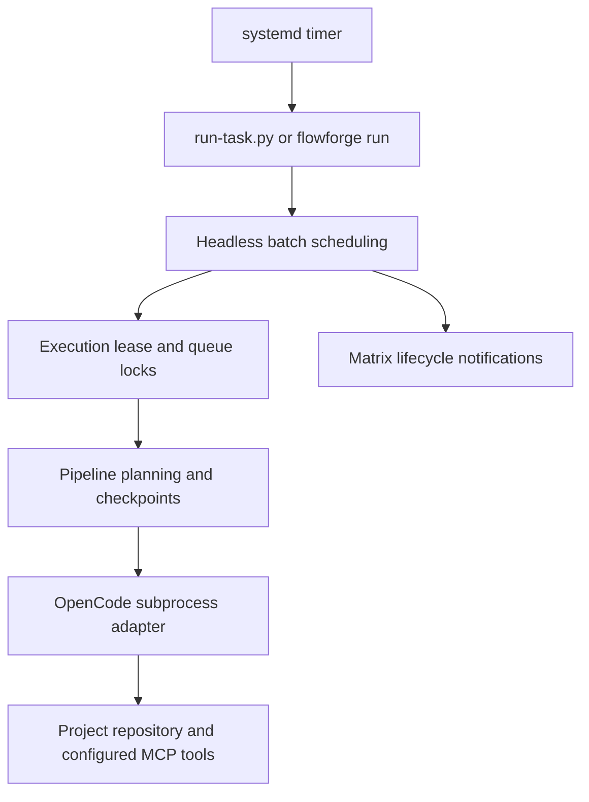

# FlowForge Headless Server

How to run FlowForge autonomously on a Linux home server (e.g. a Raspberry Pi 5)
without the TUI: a systemd timer triggers `run-task.py`, which processes one or
more queued tasks and sends Matrix notifications about the task lifecycle.



The TUI (`python3 tasks-ui.py`) keeps working against the same `tasks.jsonl`
and is unaffected by the headless setup. Serena is configured on the OpenCode
side; FlowForge does not start, stop, or expose it — it only launches OpenCode
with `PROJECT_DIR` as the working directory, so OpenCode/Serena detect the
target project themselves.

## Registered projects

The environment-based deployment below remains supported. For a shared installation,
follow [project setup](projects.md) and [migration](migration.md). The example
[template service](../deploy/flowforge@.service) and
[template timer](../deploy/flowforge@.timer) run one registered directory-mode project
per instance, using absolute configuration/state roots and the same locks as manual,
TUI and Hermes commands. For a JSONL-only registration remove --sync from ExecStart.
Customize the service user, installation paths and executable path in project JSON.
Use a private notifications.env for credentials. Enable an instance only after
preflight and cutover verification, for example `flowforge@smart-home.timer`.
Cron may invoke `/opt/flowforge/flowforge run --project smart-home --max-tasks 3 --json`
with the same explicit roots; add --sync only for a directory source. No embedded
scheduler or daemon is needed.

## 1. Dependencies

- Python 3.10+ (stdlib only for the headless path; no new packages)
- `opencode` installed on the server and callable by the service user
- The TUI additionally needs the pinned packages in `requirements-ui.txt`;
  install them in a virtual environment with `python -m pip install -r requirements-ui.txt`
- Matrix notifications use the plain HTTP client-server API via `urllib` — no
  Matrix SDK is installed

## 2. Server installation

```bash
sudo -i
apt update && apt install -y python3 git  # as needed
install -d -o YOUR_USER -g YOUR_USER /opt/flow-forge-tui
sudo -u YOUR_USER git clone https://github.com/zmzm/flow-forge-tui /opt/flow-forge-tui
cd /opt/flow-forge-tui
sudo -u YOUR_USER python3 scripts/check.py --stdlib-only
```

Replace `YOUR_USER` with the service account. It must be able to read the code and
configuration and write the selected queue, runs and artifact locations. The check
command compiles the Python sources and runs tests without installing UI or
development tools. For contributor checks, see [the development guide](development.md).

## 3. `.env` configuration

```bash
cd /opt/flow-forge-tui
cp .env.example .env
chmod 600 .env
chown YOUR_USER:YOUR_USER .env
nano .env
```

Required: `PROJECT_DIR` and `TASKS_FILE` (same values the TUI uses).
`steps.json` is expected next to `TASKS_FILE`. Optional batch settings:

| Variable | Default | Meaning |
|---|---|---|
| `FLOWFORGE_MAX_TASKS_PER_RUN` | `1` | Max tasks processed per invocation (`1` = legacy single-task behavior) |
| `FLOWFORGE_STOP_ON_FAILURE` | `true` | Stop the batch when a task fails; `false` = record and continue |
| `FLOWFORGE_MAX_RUNTIME_SECONDS` | `14400` | Do not *start* another task after this many seconds; `0` = unlimited. A running task is never killed because of this limit |
| `FLOWFORGE_STEP_TIMEOUT_SECONDS` | `3600` | Kill a single hung OpenCode step (SIGTERM, then SIGKILL after 10s) and mark the task failed; `0` = unlimited |
| `FLOWFORGE_HEARTBEAT_SECONDS` | `30` | Emit process information while a step is quiet; `0` disables heartbeats |
| `FLOWFORGE_RUNS_DIR` | `runs` | Directory for run logs and the lock file (relative to the working directory unless absolute) |
| `OPENCODE_BIN` | `opencode` | Explicit path to the opencode executable |
| `MATRIX_ENABLED` | `false` | Enable Matrix notifications |
| `MATRIX_HOMESERVER` / `MATRIX_ROOM_ID` / `MATRIX_ACCESS_TOKEN` | — | Matrix settings (required when enabled) |
| `MATRIX_TIMEOUT_SECONDS` | `10` | HTTP timeout for Matrix requests |

`.env` is gitignored. Never commit it or the access token.

Exit codes of `run-task.py`: `0` = run completed (also when the queue is empty
or another run holds the lock), `1` = one or more tasks failed, `2` =
configuration/startup error (missing env, unreadable `tasks.jsonl`, unknown
`--task-id`, Matrix enabled but misconfigured). A Matrix *delivery* failure
never changes the task result or the exit code.

## 4. OpenCode requirements

OpenCode must be installed and authenticated for the service user (run
`opencode` once interactively as that user if login is required). The scheduled
process does **not** read `~/.bashrc`/`~/.profile`, so do not rely on a
PATH extended there. Either:

- set `OPENCODE_BIN=/home/YOUR_USER/.local/bin/opencode` (recommended,
  deterministic), or
- extend `Environment=PATH=` in the service file.

FlowForge launches OpenCode with `cwd=PROJECT_DIR` (and `--dir`), which is also
what makes OpenCode pick up the correct project (and later Serena MCP).

## 5. Headless manual execution

```bash
cd /opt/flow-forge-tui
python3 run-task.py                 # next task with status todo
python3 run-task.py --task-id f2-d8 # a specific task
python3 run-task.py --max-tasks 3   # override FLOWFORGE_MAX_TASKS_PER_RUN
```

Manual runs use the same batch limits, locking, and notifications as scheduled
runs. An empty queue exits 0 without lifecycle notifications. Legacy automatic
selection uses the task-id month gate; registered projects enable it only with
`month_gate: true`. A gated batch with only future tasks exits 0 with reason
`month_gated` and sends the corresponding run summary.

## 6. Matrix setup

1. Create a Matrix account for the bot / your homeserver.
2. Get its access token (Element: Settings → Help & About, or the login API).
3. Invite the account to the room you want notifications in and note the room
   id (looks like `!xxxxxxxx:example.com`; ensure the bot may post).
4. Fill `MATRIX_HOMESERVER`, `MATRIX_ROOM_ID`, `MATRIX_ACCESS_TOKEN` in `.env`
   and set `MATRIX_ENABLED=true`.

You will get, at most: one message per task started, one per task
completed/failed, and one summary per scheduled run. Error messages are capped
at 500 characters and full output stays in the server logs. If Matrix is down,
FlowForge logs the failure and continues normally.

## 7. systemd service installation

```bash
sudo cp deploy/flowforge.service /etc/systemd/system/
sudo nano /etc/systemd/system/flowforge.service   # replace YOUR_USER and /opt/flow-forge-tui
sudo systemctl daemon-reload
```

`Type=oneshot` with `TimeoutStartSec=0` lets a long batch finish; concurrent
invocations are impossible anyway thanks to the lock file (see below).

## 8. systemd timer installation (daily at 03:00)

```bash
sudo cp deploy/flowforge.timer /etc/systemd/system/
sudo systemctl daemon-reload
sudo systemctl enable --now flowforge.timer
```

`Persistent=true` starts the job after boot if the scheduled moment was missed
while the machine was off — important on a Pi that may be powered down at
03:00.

## 9. Checking status

```bash
systemctl status flowforge.timer
systemctl status flowforge.service
systemctl list-timers flowforge.timer
```

## 10. Viewing logs

The runner logs to stdout/stderr, so everything lands in the journal:

```bash
journalctl -u flowforge.service            # last runs
journalctl -u flowforge.service -f         # follow a running batch
journalctl -u flowforge.service --since today
```

Per-task OpenCode transcripts remain in `runs/<timestamp>_<uuid>_<task_id>.log`
(relative to the working directory) and the path is stored in each task's
`last_run_log`. Lines are appended as they arrive, including heartbeats during quiet
steps. Project registrations can select another runs directory. Matrix credentials
are not added to task commands; OpenCode transcripts can contain task contents and
upstream tool/provider output, so treat run logs as private operational data.

## 11. Manually triggering a run

```bash
sudo systemctl start flowforge.service     # production service, in the journal
# or, without systemd:
sudo -u YOUR_USER sh -c 'cd /opt/flow-forge-tui && exec /usr/bin/python3 ./run-task.py'
```

## 12. Disabling scheduled execution

```bash
sudo systemctl disable --now flowforge.timer
```

## Execution and queue locks

The shared execution lease acquires exclusive locks in fixed order: canonical
workspace, canonical queue, then `runs/.flowforge.lock` (or the configured runs
directory). This coordinates aliases, registered projects, legacy CLI invocations
and TUI runs for the same resources. Another owner produces a busy result and exit
0 without executing tasks or recovering its active rows. A busy result does not
mean the requested task completed. Locks coordinate one OS user on one host;
separate users, containers or hosts require a shared deployment strategy.

Queue mutations use a separate short transaction lock and re-read the latest queue
before replacing it. Inspecting status is read-only. During normal completion,
failure, stop or timeout, subprocess cleanup finishes before the execution lease
releases its locks. The OS also releases file locks when their owning process exits.

Additional safety nets:

- `tasks.jsonl` is rewritten using a temporary file, `os.replace` and fsync.
  Field updates merge into the latest queue under its transaction lock, preserving
  unrelated concurrent edits. External writers must use the same protocol.
- While a task executes it is marked `running` in `tasks.jsonl`. If the
  process dies, the next execution lease converts stale `running` tasks to
  `failed` while holding the execution locks. Automatic batches select only
  `todo`; explicitly select a failed task with `--task-id` or the TUI to resume it.
- Resume verifies persisted successful checkpoints, including source/workflow and
  input/output hashes. Partial files from a failed step do not prove completion.
  Older failed rows without checkpoints rerun their unverified steps. The saved
  session is reused for the first resumed step only when its recorded step and
  revision match. CLI and TUI attempts both retain history.
- Each OpenCode step is bounded by `FLOWFORGE_STEP_TIMEOUT_SECONDS` (default
  1h): a hung process gets SIGTERM, then SIGKILL, and the task is marked
  failed. `FLOWFORGE_MAX_RUNTIME_SECONDS` bounds starting additional tasks; it
  allows the task already in flight to finish.

## Testing this setup

```bash
python3 scripts/check.py --stdlib-only    # compile and test; Matrix fully mocked
python3 run-task.py                        # manual smoke run
sudo systemctl start flowforge.service && journalctl -u flowforge.service -f
```

The last two commands execute real queued work. Use a disposable workspace and
queue for a smoke test before enabling the production timer.
